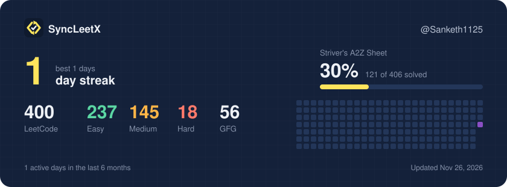

# Sanketh1125's DSA solutions

Every accepted solution from LeetCode and GeeksforGeeks, committed automatically by [SyncLeetX](https://chromewebstore.google.com/detail/syncleetx/dcnjkjgbpogajgdcbafclhmgeobkjlan).

## Recently solved

| | Problem | Difficulty | Language | Solved |
|:-:|---|:-:|:-:|:-:|
| 🟢 | [Sorted and Rotated Minimum](https://www.geeksforgeeks.org/problems/minimum-element-in-a-sorted-and-rotated-array3611/1) GFG | Easy |  | Nov 26 |
| 🟢 | [Two Sum](https://leetcode.com/problems/two-sum/) | Easy |  | Nov 26 |

## Sheets

| Sheet | Progress | Solved |
|---|---|--:|
| Striver's A2Z Sheet | `██████░░░░░░░░░░░░░░` 30% | **121** / 406 |
| NeetCode 150 | `█████████░░░░░░░░░░░` 45% | **68** / 150 |
| Apna College DSA Sheet | `████████░░░░░░░░░░░░` 38% | **74** / 193 |
| Apna College DP Sheet | `██░░░░░░░░░░░░░░░░░░` 8% | **4** / 50 |

## Strongest topics

`Array 172` `String 107` `Hash table 62` `Two pointers 46` `Trees 45` `Graphs 45`

---

Tracked with [SyncLeetX](https://chromewebstore.google.com/detail/syncleetx/dcnjkjgbpogajgdcbafclhmgeobkjlan). This README and the card above update on every accepted solution.
